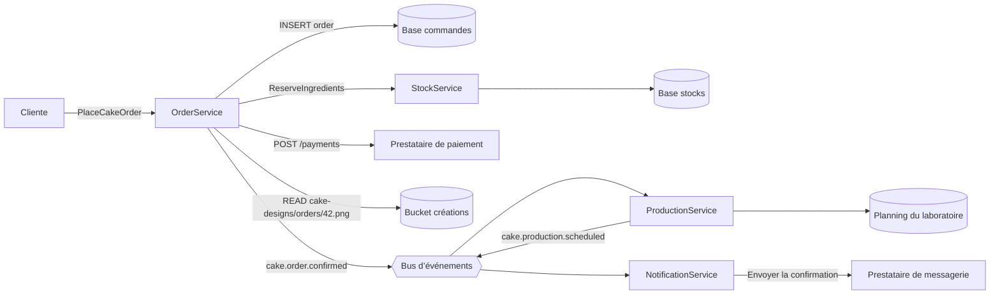
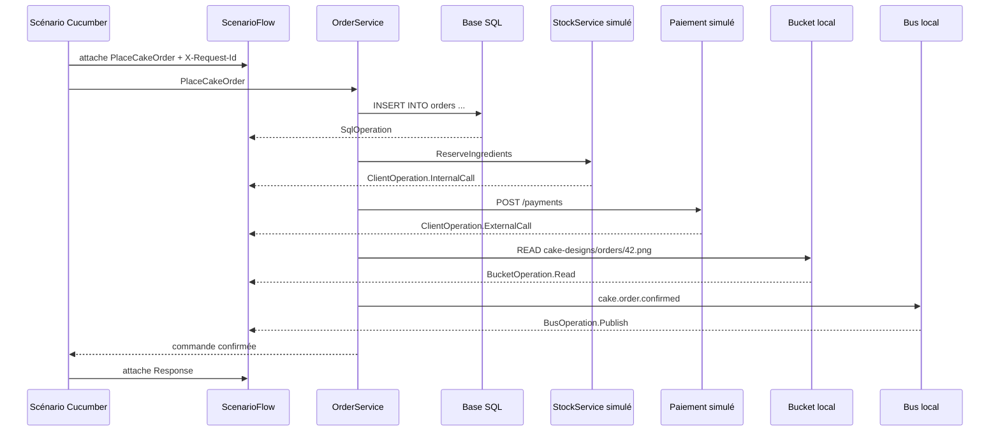
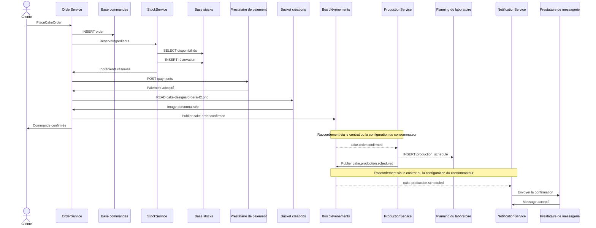
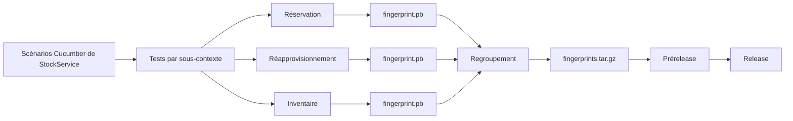
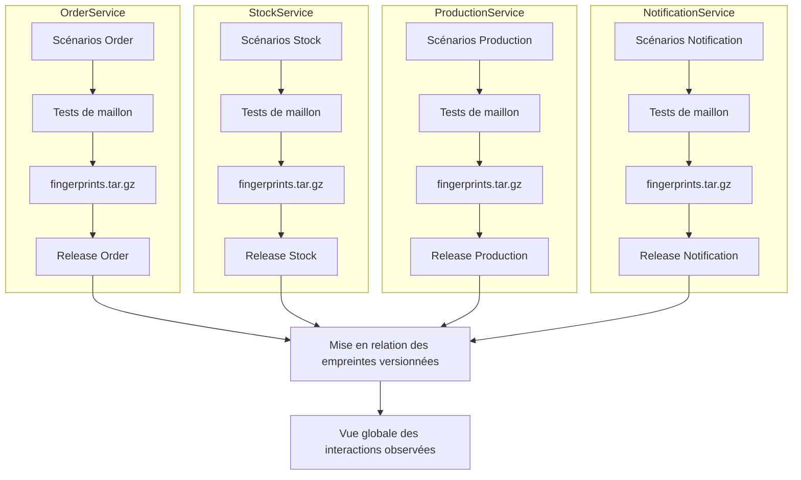

<!-- markdownlint-disable-file -->


Il est huit heures, un samedi matin. Une cliente commande un gâteau d’anniversaire personnalisé sur le site de sa boulangerie. Elle choisit la recette, indique le nombre de parts, joint une image d’inspiration et règle sa commande. Quelques secondes plus tard, elle reçoit une confirmation : son gâteau sera prêt à 16 heures.

Pour elle, une seule action vient d’avoir lieu : **commander un gâteau**.

Dans le système d’information de la boulangerie, l’histoire est plus longue. Le service de commande a enregistré la demande, vérifié les ingrédients auprès du service de stock, sollicité un prestataire de paiement, consulté l’image déposée dans un bucket et publié un événement. Le service de production peut maintenant planifier la préparation, puis le service de notification peut prévenir la cliente.

Chaque équipe connaît bien son atelier. **Mais si nous demandons ce qui s’est réellement passé entre le clic de la cliente et la confirmation de sa commande****, la réponse se trouve dispersée entre plusieurs services, bases de données, messages et dépendances externes**.

C’est précisément le problème auquel nous avons voulu répondre avec les tests de maillon : **conserver une emprunte des tests pour chaque service tout en rendant progressivement lisible le parcours global.**

> Une empreinte est une cartographie comportementale construite à partir des chemins réellement traversés par les scénarios. Elle n’inventorie pas tout le code possible : elle raconte ce que les tests ont effectivement observé.

## Une boulangerie devenue système distribué

Notre boulangerie a grandi. Le cahier posé derrière le comptoir a laissé place à plusieurs applications spécialisées :

- `OrderService` prend les commandes et conserve leur état ;

- `StockService` réserve la farine, les œufs, le chocolat et les autres ingrédients ;

- `ProductionService` organise le travail du laboratoire ;

- `NotificationService` informe les clients ;

- un prestataire externe traite les paiements ;

- un bucket conserve les images et documents liés aux créations personnalisées ;

- un bus transporte les événements entre les ateliers.

Ce découpage permet à chaque équipe de faire évoluer son domaine. Il crée aussi des interdépendances. Une modification locale peut désormais avoir des conséquences ailleurs : renommer une méthode de réservation bloque les commandes, modifier un événement empêche la production de démarrer, déplacer une image change la clé attendue dans le bucket.

La commande de notre cliente ressemble alors à ceci :



Ce diagramme est facile à dessiner pour un exemple. Dans un vrai système, il pose plusieurs questions : est-il encore à jour ? D’où viennent ses flèches ? Les dépendances représentées ont-elles été vérifiées ? Et que manque-t-il parce que personne ne savait qu’il fallait le dessiner ?

### Le réflexe du test de bout en bout

Une réponse majoritairement établie consiste à tester toute la commande de bout en bout. Nous déployons tous les services, préparons leurs données, configurons le bus, le stockage et les partenaires, puis jouons le parcours de la cliente.

Ce test E2E apporte une preuve précieuse : le parcours fonctionne dans cet environnement. Mais plus la boulangerie s’agrandit, plus cette preuve coûte cher à obtenir. L’environnement devient difficile à reproduire, les données partagées rendent les tests sensibles les uns aux autres et, lorsqu’un scénario échoue, il faut remonter toute la chaîne avant de trouver l’atelier responsable.

Nous ne voulons pas abandonner les tests E2E. Nous voulons répondre à une question complémentaire : **comment comprendre précisément chaque maillon sans devoir démarrer toute la chaîne ?**

|  | Test E2E | Test de maillon |
| --- | --- | --- |
| Point de vue | Parcours global | Comportement d’un service |
| Environnement | Plusieurs services déployés | Service réel, frontières maîtrisées |
| Preuve principale | Le parcours complet fonctionne | Le service répond et interagit comme attendu |
| Diagnostic | Réparti sur toute la chaîne | Rattaché au maillon testé |
| Dépendances | Réelles ou partagées | Simulées, observées et vérifiables |


## Tester un atelier sans reconstruire toute la boulangerie

Prenons `OrderService`. Son test de maillon l’appelle par son véritable point d’entrée, l’API HTTP, avec une requête représentative. Le code du service s’exécute réellement, mais ses frontières sont placées sous contrôle : base de test, clients internes et externes simulés, bus local et bucket local.

Le scénario métier reste lisible par l’équipe :

```gherkin
Rule: Commander un gâteau personnalisé

  Scenario: La commande est acceptée lorsque les ingrédients sont disponibles
    Given les ingrédients du gâteau sont disponibles
    And le paiement sera accepté
    And l'image "orders/42.png" existe dans le bucket des créations
    When la cliente commande un gâteau pour 10 personnes
    Then la commande est confirmée
    And un événement de commande confirmée est publié
```

Ce scénario vérifie le résultat attendu. Pendant son exécution, les adaptateurs de test voient également passer les effets techniques :



Le test apporte ainsi deux informations liées : le scénario exprime **pourquoi** le comportement compte pour le métier ; les interactions observées montrent **comment** le service collabore avec le reste du système pour produire ce résultat.

### Du journal local à l’empreinte

Cette observation devient l’empreinte du service de commande. Elle peut dire, pour ce scénario :

- quelle méthode a été appelée et avec quelle structure de données ;

- quelle requête SQL a été exécutée ;

- quelle méthode interne a été sollicitée ;

- quelle API externe a reçu un appel ;

- quel objet a été lu dans quel bucket ;

- quel événement a été publié ;

- quelle réponse a été retournée.

L’empreinte n’est donc pas une liste de dépendances déclarées à la main. Elle est la trace structurée d’un comportement réellement exercé et vérifiable en test.

## Rapprocher les empreintes pour retrouver l’histoire complète

Le service de stock possède ses propres scénarios. Son empreinte montre que `ReserveIngredients` consulte les quantités disponibles et écrit les réservations en base. Le service de production possède lui aussi ses scénarios : lorsqu’il planifie un gâteau, il consulte le planning du laboratoire et publie `cake.production.scheduled`. Enfin, l’empreinte du service de notification révèle l’appel au prestataire de messagerie.

Chaque empreinte éclaire un atelier. Leur mise en relation permet de retrouver progressivement la circulation de la commande dans la boulangerie :

```plain text
Empreinte OrderService
├── appelle StockService.ReserveIngredients
├── appelle POST /payments
├── lit cake-designs/orders/42.png
└── publie cake.order.confirmed

Empreinte StockService
└── expose ReserveIngredients
    ├── lit les quantités disponibles
    └── écrit une réservation

Empreinte ProductionService
└── exécute ScheduleCake
    ├── écrit dans le planning
    └── publie cake.production.scheduled

Empreinte NotificationService
└── exécute NotifyCustomer
    └── appelle le prestataire de messagerie
```

Une fois ces empreintes versionnées rapprochées, elles peuvent être projetées sous la forme d’un diagramme de séquence. Nous ne regardons plus seulement la liste des voisins de chaque service : nous retrouvons le voyage de la commande et la causalité entre les interactions observées dans chaque maillon.



Les flèches pleines proviennent des interactions visibles dans les empreintes des services concernés. Les flèches en pointillés représentent le raccordement d’un événement publié avec son consommateur ; cette relation requiert le contrat ou la configuration de souscription en complément de l’empreinte actuelle. Le diagramme obtenu ne prétend donc pas être une trace distribuée capturée lors d’une exécution unique : il recompose un parcours cohérent à partir de preuves locales.

Cette projection rend immédiatement visibles les appels en cascade, les passages synchrones et asynchrones, ainsi que le service à l’origine de chaque accès aux données ou à une ressource externe. Elle apporte une lecture proche de celle recherchée dans un test E2E, tout en permettant de revenir à l’empreinte et au scénario précis qui justifient chaque segment du parcours.

Le rapprochement rend les interdépendances concrètes. Il devient possible d’identifier les services touchés par une évolution, de repérer un appel interne sans point d’entrée correspondant, de retrouver les producteurs d’un événement, ou encore de découvrir un bucket et une requête SQL absents de la documentation d’architecture.

Il faut toutefois distinguer ce qui est enregistré de ce qui est déduit. L’empreinte actuelle capture notamment les événements **publiés**. Elle ne reconstruit pas automatiquement toute leur chaîne de consommation. Relier`cake.order.confirmed` au déclenchement de `ProductionService` demande aussi de connaître le contrat ou la configuration du consommateur. La carte globale devient plus précise à mesure que les sources de connaissance sont rapprochées.

Et surtout, une dépendance jamais traversée par un scénario ne peut pas apparaître. Une zone blanche dans la carte peut signifier qu’il ne se passe rien — ou simplement que nous ne l’avons pas encore observée.

## Dans les coulisses : comment `ScenarioFlow` construit l’empreinte

La boulangerie rend le problème visible. Revenons maintenant au mécanisme qui transforme un scénario Cucumber en artefact exploitable :

```plain text
TestSuiteFlow
└── ScenarioFlow                         un scénario Cucumber
    ├── ScenarioDefinition               feature, rule, scénario, tags, URI
    └── RequestFlow                      un appel entrant ou un worker
        ├── Request                      méthode, corps, en-têtes, identifiant
        └── RequestFact<?>               faits observés dans l'ordre de leur exécution
            ├── SqlOperation
            ├── ClientOperation
            ├── BusOperation
            ├── BucketOperation
            ├── Response
            └── Worker.Result
```

`ScenarioFlow` définit le contrat. Un flux représente un scénario, accepte ses requêtes et permet de retrouver le `RequestFlow` courant ou celui qui correspond à un identifiant précis. Chaque `RequestFlow` conserve ensuite la requête entrante et les faits observés pendant son traitement.

Son implémentation `GherkinScenarioFlow` utilise des files concurrentes. Un scénario peut contenir plusieurs appels, y compris en parallèle, tout en conservant les faits associés à chacun.

### Ouvrir la bonne fenêtre d’observation

La collecte suit le cycle de vie Cucumber :

- `ScenarioLifecycle` identifie la feature, la `Rule`, le scénario, ses tags et son URI ;

- le hook `PREPARE` crée un nouveau `GherkinScenarioFlow` ;

- les listeners SQL, bus, clients et storage commencent à écouter **après** le chargement des fixtures ;

- le point d’entrée est exécuté et les faits sont attachés à son `RequestFlow` ;

- les listeners s’arrêtent **avant** le nettoyage des fixtures ;

- le scénario est transmis pour écriture dans le catalogue d’empreintes `Protobuf`.

Les requêtes utilisées pour préparer ou vider la base ne décrivent pas le comportement du service. Cette fenêtre évite donc de les confondre avec les interactions produites par la commande de gâteau.

### Corréler les faits avec la bonne requête

Dans un scénario séquentiel, un fait peut être rattaché à la dernière requête ouverte. Cela ne suffit plus lorsque plusieurs clientes commandent simultanément ou lorsque des actions internes sont réalisées en concurrence.

Chaque `Request` reçoit un identifiant ordonné dans le temps. Le client de test le propage dans `X-Request-Id`. Lorsqu’un listener cherche la requête courante, `CucumberTestSuiteFlow` consulte le contexte de métadonnées :

- si `X-Request-Id` est disponible, il retrouve le `RequestFlow` correspondant ;

- sinon, il se rabat sur la dernière requête attachée.

Ainsi, le paiement et la réservation d’ingrédients de la commande 42 ne viennent pas enrichir par erreur l’empreinte de la commande 43. Cette garantie dépend de la propagation correcte de la métadonnée jusqu’à la publication de l’événement d’audit.

### Une mécanique commune pour toutes les frontières

Chaque adaptateur instrumenté publie un événement d’audit. Un listener l’attache au `RequestFlow` courant, puis `RequestFact` le présente à un visiteur typé.

| Frontière observée | Fait dans le code (Java) | Interaction Protobuf | Données conservées |
| --- | --- | --- | --- |
| Base de données | SqlOperation | SqlInteraction | statement SQL |
| Service interne | ClientOperation.InternalCall | InternalCallInteraction | méthode, en-têtes, corps, réponse |
| Partenaire externe | ClientOperation.ExternalCall | ExternalCallInteraction | méthode HTTP, URI, en-têtes, corps, réponse |
| Bus | BusOperation.Publish | EventInteraction | topic, payload |
| Stockage objet | BucketOperation | BucketInteraction | bucket, clé, opération |


Le proxy `DataSource` observe le SQL avant son exécution. Les clients internes et les serveurs externes WireMock publient leurs appels, qu’ils réussissent ou échouent. Le bus et le bucket locaux publient respectivement les messages envoyés et les opérations `READ`, `WRITE` ou `DELETE`.

Le contenu d’un fichier écrit peut être utilisé par les assertions du test, mais l’empreinte du bucket ne conserve que son emplacement et l’opération. À l’inverse, les appels internes et externes peuvent contenir des en-têtes, des corps et des réponses : les scénarios doivent donc employer des données synthétiques et ne jamais y introduire de secrets.

### Structurer le catalogue d’empreinte Protobuf

`ProtoScenarioFlowPrinter` transforme les faits grâce au pattern Visitor `FactToInteractionVisitor`. Le schéma `Protobuf` transforme un fait en `Interaction` .

Le résultat suit cette hiérarchie :

```plain text
Catalog
└── Endpoint                         regroupé par URI de feature
    └── Rule                         règle Gherkin ou "default"
        └── Scenario                 exécution d’un scénario
            └── Step                 requête entrante
                ├── called_method
                ├── body
                ├── interactions[]
                └── response
```

Les payloads JSON gardent leur contenu et une représentation de leur structure. Une commande comme :

```json
{
  "customerId": "customer-7",
  "cake": {
    "servings": 10,
    "flavours": ["chocolate", "raspberry"]
  },
  "design": {
    "bucket": "cake-designs",
    "key": "orders/42.png"
  }
}
```

produit notamment les chemins suivants :

```plain text
customerId
cake.servings
cake.flavours[]
design.bucket
design.key
```

Cette double représentation permet de documenter les données observées tout en comparant leur forme. Si un contenu n’est pas un JSON analysable, comme un statement SQL, sa structure reste vide et son contenu brut est conservé.

Une vue JSON simplifiée de l’empreinte d’`OrderService` ressemblerait à ceci :

```json
{
  "calledMethod": "OrderService.PlaceCakeOrder",
  "body": {
    "structure": ["customerId", "cake.servings", "cake.flavours[]", "design.bucket", "design.key"],
    "content": {
      "customerId": "customer-7",
      "cake": { "servings": 10, "flavours": ["chocolate", "raspberry"] },
      "design": { "bucket": "cake-designs", "key": "orders/42.png" }
    }
  },
  "interactions": [
    { "sql": { "query": { "content": "insert into orders ..." } } },
    { "internalCall": { "method": "StockService.ReserveIngredients" } },
    { "externalCall": { "httpMethod": "POST", "uri": "/payments" } },
    { "bucket": { "bucket": "cake-designs", "key": "orders/42.png", "operation": "READ" } },
    { "event": { "eventName": "cake.order.confirmed" } }
  ],
  "response": {
    "structure": ["orderId", "status", "pickupAt"],
    "content": { "orderId": 42, "status": "CONFIRMED", "pickupAt": "2024-06-15T16:00:00Z" }
  }
}
```

Toutes les dépendances restent ainsi rattachées à la méthode et au scénario qui les ont provoquées.

## Des tests à un artefact versionné

Après chaque scénario, `ProtoScenarioFlowPrinter` ajoute son flux au catalogue. Après toute la suite, le hook Cucumber `@AfterAll` écrit le catalogue binaire dans `target/fingerprint/catalog.pb` et en affiche une représentation JSON dans les logs.

La CI exécute les features séparément selon leur contexte. Chaque shard produit son catalogue, que l’image de test copie sous le nom `fingerprint.pb`. Les empreintes sont ensuite vérifiées, regroupées par contexte dans`fingerprints.tar.gz`, attachées à la prérelease, puis promues avec la release du service.

Le premier schéma se place volontairement **à l’échelle d’un seul service**. Prenons `StockService` : ses scénarios de réservation, de réapprovisionnement et d’inventaire peuvent être exécutés dans des shards distincts, mais ils alimentent tous l’artefact associé à une même release de `StockService`.



Dans une architecture microservices, cette chaîne existe indépendamment dans chaque dépôt. `OrderService`,`StockService`, `ProductionService` et `NotificationService` exécutent leurs propres scénarios, construisent leur propre bundle d’empreintes et le publient avec leur propre release. La mise en relation intervient ensuite, à partir de ces artefacts déjà produits et versionnés :



Il n’existe donc pas une release technique commune qui fabriquerait l’empreinte de toute la boulangerie. Chaque service reste autonome et publie la photographie comportementale correspondant à sa version. C’est seulement après cette étape que les empreintes peuvent être rapprochées : l’appel `StockService.ReserveIngredients` observé chez `OrderService` peut, par exemple, être mis en regard des scénarios exposant cette méthode dans la release de `StockService`.

L’empreinte reste ainsi au plus près de la version du service qui l’a produite. Comparer deux releases d’un même service peut révéler une nouvelle dépendance, une interaction disparue ou une structure de données qui a changé. Comparer les releases de plusieurs services permet, de son côté, de rapprocher les pièces du parcours global tout en conservant leur origine et leur version.

## Conclusion : de la connaissance d’un atelier à celle de la boulangerie

Un scénario fidèle traduit la compréhension qu’une équipe possède de son métier : les situations importantes, les règles à préserver, les partenaires sollicités et les effets attendus. Dans notre boulangerie, l’équipe commande sait ce qui rend une commande acceptable ; l’équipe stock connaît les règles de réservation ; l’équipe production sait transformer cette commande en travail réalisable.

L’empreinte relie ce savoir métier aux interactions qui le mettent en œuvre. La requête SQL, le service appelé, l’événement publié ou l’objet lu dans un bucket ne sont plus des dépendances isolées : ils deviennent les conséquences observables d’un besoin compris, raconté et vérifié par l’équipe.

Des scénarios entretenus collectivement conservent ainsi le savoir dans un format lisible par les équipes et vérifiable par l’exécution. Lorsque le métier évolue, faire évoluer les scénarios maintient ensemble la compréhension fonctionnelle, la preuve technique et la cartographie des interactions.

Enfin, la somme des empreintes retrouve une problématique que les tests E2E classiques cherchent, eux aussi, à résoudre : savoir, avec le plus d’exhaustivité possible, ce qui s’est passé lorsqu’une action a traversé tout ou partie du système d’information. Là où un test de maillon éclaire précisément un atelier, la mise en relation des empreintes reconstitue progressivement le voyage de la commande entre tous les ateliers de la boulangerie.

Cette vision ne vaut que pour les parcours réellement exécutés et les interactions effectivement instrumentées. Son exhaustivité ne se décrète pas : elle se construit avec la qualité, la diversité et la représentativité des scénarios. Plus les équipes racontent fidèlement leur métier, plus la somme de leurs empreintes devient une compréhension partagée du système tout entier.