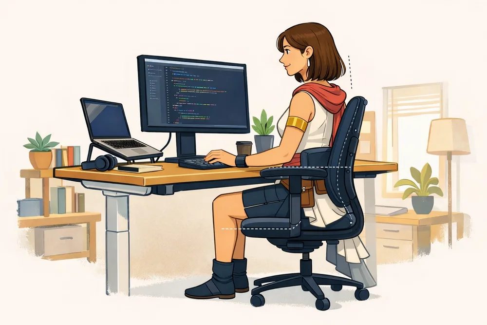
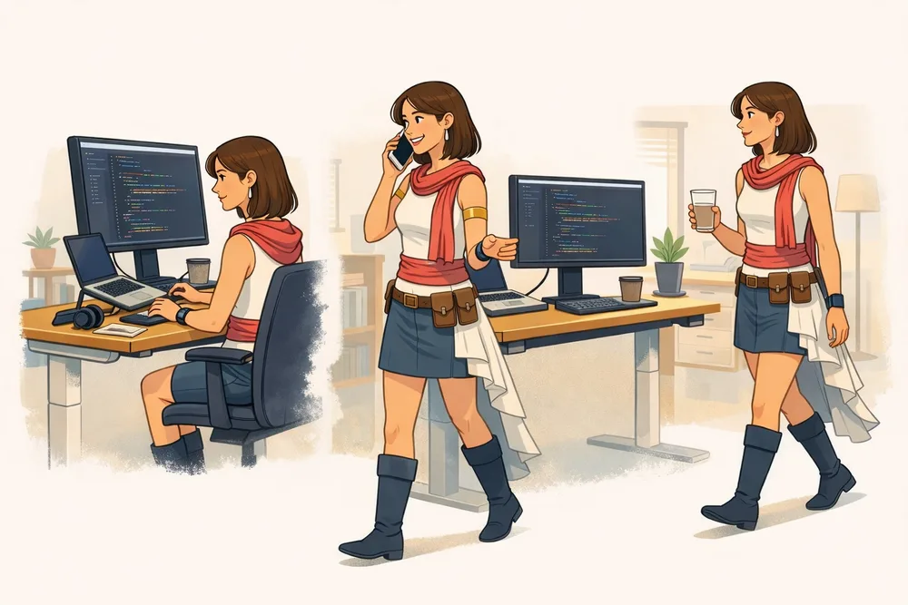

<!-- markdownlint-disable-file -->

On passe des dizaines d’heures par semaine devant un écran, à traquer des fuites de mémoire, à réduire la dette technique ou à concevoir des systèmes résilients. Pendant ce temps, une nuque raide, des épaules tendues ou des yeux fatigués finissent facilement par faire partie du quotidien.

Ces gênes ne viennent pas toujours d’un mauvais équipement. Un écran trop bas, une souris trop éloignée ou des pieds qui ne touchent pas le sol peuvent suffire à rendre une journée pénible. Ce guide rassemble les réglages que j’ai testés sur mon propre poste et les repères qui m’ont aidé à l’améliorer. Ils ne définissent pas une posture parfaite : chacun doit les adapter à sa morphologie, à son matériel et à ses usages.

> ⚠️ Une douleur n’est pas un simple warning à masquer. Si elle persiste, s’intensifie ou s’accompagne de fourmillements, mieux vaut consulter un professionnel de santé ou solliciter la médecine du travail.

## **Le « laptop nu » : un compromis qui ne tient pas sur la durée**

Poser son ordinateur portable sur une table et travailler directement dessus reste pratique pendant une heure, mais le compromis devient inconfortable quand la journée se prolonge.

L’écran et le clavier étant solidaires, il est impossible de bien placer les deux en même temps. Lorsque l’écran est assez haut pour garder la tête dans une position confortable, le clavier devient inaccessible ; lorsqu’il est à portée des mains, l’écran invite à pencher la tête. C'est d'ailleurs pourquoi le Pôle Santé Travail recommande d'associer un écran réhaussé, un clavier et une souris déportés dès que l'on travaille plus de 2 heures par jour sur un ordinateur portable.

Pour éviter ce compromis, il faut **séparer l’affichage de la saisie** :

- Tu peux d’abord surélever le portable avec un support stable ; une pile de livres suffit pour tester le réglage.

- Tu auras ensuite besoin d’un clavier et d’un dispositif de pointage externes.

- Le haut de l’écran peut arriver autour du niveau des yeux, ou un peu plus bas selon ton confort et ta correction visuelle.

- Une distance de 50 à 70 cm (approximativement la longueur d'un bras) convient souvent, à condition que tu puisses lire sans avancer la tête.

Si tu portes des verres progressifs, un écran légèrement plus bas peut éviter de lever le menton pour regarder à travers la bonne zone des verres.

De mon côté, j’ai choisi un bon clavier mécanique. Avec l’essor des outils d’IA, je passe de plus en plus de temps à écrire, que ce soit du code, des prompts ou de la documentation. Le son et le retour des touches m’apaisent et m’aident à structurer mes idées. Ce confort reste très personnel et ne remplace pas un bon positionnement : le clavier doit avant tout me permettre de garder les poignets dans le prolongement des avant-bras. Une astuce souvent rappelée par le Pôle Santé Travail consiste d'ailleurs à **replier les pattes escamotables sous le clavier** : travailler avec un clavier à plat évite d'imposer une cassure vers l'arrière au niveau des poignets. Un modèle compact peut aussi rapprocher la souris, tandis qu’un clavier séparé ou _split_ conviendra mieux à certaines personnes.

L’ergonomie de saisie ne s’arrête pas au matériel, elle passe aussi par nos habitudes logicielles. Apprendre les raccourcis clavier de ton IDE, de ton navigateur ou utiliser un lanceur d’applications permet de limiter les allers-retours répétitifs vers la souris. Moins de mouvements brusques vers le côté signifie moins de fatigue accumulée dans l’épaule et le poignet. Si l’utilisation d’une souris classique reste une source de tension au poignet, des alternatives comme une souris verticale (qui respecte l’alignement naturel de l’avant-bras) ou un trackball méritent d’être testés.

> 

## **Commencer par la chaise, puis régler le reste**

Régler chaque élément séparément donne rarement un résultat cohérent, car une chaise que l’on remonte change aussitôt la position des bras et le regard. L’ordre dépend surtout du bureau. S’il est réglable en hauteur, je commence par la chaise, puis j’ajuste le plateau à la hauteur de mes coudes avant de placer le clavier et l’écran. S’il ne l’est pas, sa hauteur devient la contrainte de départ : je règle la chaise pour placer correctement mes bras, puis j’ajoute un repose-pieds si mes pieds ne touchent plus le sol. Dans les deux cas, le clavier et l’écran viennent ensuite.

### **1. Poser les pieds**

Règle d’abord la hauteur d’assise pour que tes pieds reposent à plat sur le sol et que l’arrière des genoux ne soit pas comprimé. Si le bureau est trop haut et non réglable, monte la chaise et ajoute un repose-pieds stable.

Les genoux proches d’un angle droit constituent un bon point de départ, pas une règle au degré près.

### **2. Soutenir le dos**

Assieds-toi au fond du siège afin que le dossier soutienne le bas du dos. Le torse peut être vertical ou légèrement incliné vers l’arrière : il n’est pas nécessaire de rester figé à 90° toute la journée.

Une chaise chère n’est pas automatiquement une chaise adaptée. La possibilité de régler la hauteur, la profondeur d’assise, le dossier et les accoudoirs compte davantage que le logo sur l’appuie-tête. L’essentiel est que le siège s’adapte à toi, et non l’inverse : une chaise qui te fige dans une seule posture, aussi ergonomique soit-elle sur le papier, finit par créer des tensions. Privilégie un modèle qui te permet de bouger librement et de changer de position sans inconfort. Un dossier inclinable, un support lombaire ajustable et des accoudoirs réglables en hauteur, profondeur et orientation (3D ou 4D) aident à trouver la bonne posture sans forcer. Si ton bureau n’est pas très profond, des accoudoirs bien ajustés deviennent d’autant plus utiles pour soulager les épaules.

De mon côté, j’ai opté pour un siège en mesh respirant, y compris sur l’assise, avec accoudoirs ajustables, support lombaire et appui-tête. Le petit plus qui change la donne : un repose-pied rétractable qui me permet de basculer presque en position allongée pendant les pauses. Je ne m’endors pas dessus, mais pouvoir relâcher complètement le dos pendant quelques minutes m’aide à repartir plus concentré ensuite.

### **3. Relâcher les épaules**

Place les coudes près du corps, les épaules relâchées et les avant-bras approximativement parallèles au sol. Un angle de 90 à 100° au niveau des coudes est un repère utile. Si ton siège possède des accoudoirs, règle-les exactement à la même hauteur que le plan de travail : tout décalage crée une cassure inconfortable au niveau des avant-bras.

Sur un plateau suffisamment profond, garde environ 10 à 15 cm devant le clavier pour offrir un appui ponctuel aux mains ou aux avant-bras. Sur un bureau étroit, des accoudoirs bien réglés peuvent prendre le relais. Dans les deux cas :

- Le bord du bureau ne doit pas comprimer les poignets pendant de longues périodes.

- La souris reste près du clavier et dans le prolongement de l’avant-bras.

- Tu peux alterner les phases avec et sans appui au lieu de verrouiller une seule position.

### **4. Régler enfin l’écran et l'environnement proche**

Centre l’écran principal devant toi, à une distance de 55 à 70 cm (la longueur d'un bras) qui permet de lire sans te pencher. Augmenter la taille du texte est souvent plus efficace que rapprocher son visage de quelques centimètres.

L'organisation des accessoires sur le bureau joue aussi un rôle direct sur les cervicales :

- **Documents papier** : si tu travailles avec des notes ou du papier, place-les entre le clavier et l'écran pour éviter les flexions et rotations répétées du cou.

- **Téléphone** : place-le du côté opposé à la souris et privilégie un casque ou des écouteurs pour les visioconférences et appels. Coincer le téléphone entre l'oreille et l'épaule est un classique déclencheur de tensions au cou.

Place également l’écran perpendiculairement aux fenêtres quand c’est possible, afin de limiter les reflets. La luminosité ambiante et le contraste comptent autant que la hauteur du moniteur pour le confort visuel.

Si tu télétravailles sans mobilier ajustable à la maison, quelques astuces recommandées par la médecine du travail permettent d'adapter ton installation :

- Ajoute un coussin sur la chaise pour remonter tes coudes à hauteur de la table.

- Glisse une serviette roulée dans le bas du dos pour soutenir le creux lombaire.

- Utilise une boîte solide ou une pile de livres sous tes pieds s'ils ne touchent pas le sol à plat.

## **Plusieurs écrans sans jouer au tennis avec sa nuque**

Avec plusieurs écrans, la bonne disposition dépend moins de leur nombre que de leur fréquence d’utilisation :

- Si tu utilises surtout un écran, centre-le face à toi et place le secondaire sur le côté (légèrement désaxé et orienté vers toi).

- Si tu répartis ton temps à égalité entre deux écrans, le Pôle Santé Travail conseille de les placer de façon symétrique face à toi, parfaitement accolés. Ils doivent ne former qu'un seul et même point de vue pour limiter les mouvements de rotation du cou.

- L’écran qui demande le plus de précision doit rester le plus directement possible dans ton axe.

- Veille à harmoniser la luminosité, le contraste, la taille du texte et la vitesse du curseur entre les deux écrans : devoir adapter tes yeux à deux affichages très différents est une source majeure de fatigue visuelle.

- Une messagerie ou un tableau de bord placé très loin sur le côté risque de t’obliger à tourner la tête toute la journée.

Un bras articulé compatible VESA libère de la place et facilite le réglage en hauteur, en profondeur et en inclinaison. Avant l’achat, vérifie la compatibilité VESA, le poids de chaque écran, l’épaisseur du plateau et le type de fixation. Si le pied fourni offre déjà les bons réglages, tu peux bien sûr le conserver.

> 

## **L’éclairage et l'environnement : trouver l’équilibre autour des écrans**

L’éclairage est facile à négliger alors qu’il participe directement au confort visuel. J’ai placé mon bureau à côté d’une fenêtre pour profiter autant que possible de la lumière naturelle. La médecine du travail préconise de placer le plan de travail perpendiculaire à la fenêtre (idéalement à environ 1,50 m), plutôt que face ou dos à elle, ce qui limite les reflets et évite d’avoir le soleil dans les yeux. Lorsque la lumière devient trop forte, un store à lamelles horizontales permet de la moduler efficacement sans assombrir complètement la pièce.

L'environnement de la pièce influe aussi sur la sécheresse oculaire : penser à aérer régulièrement le bureau pour renouveler l'air et maintenir une température idéale qui ne dépasse pas 22 °C permet d'éviter l'air sec qui irrite les yeux.

Quand la luminosité extérieure ne suffit plus, j’utilise un luminaire équipé d’une ampoule blanche connectée dont je peux régler l’intensité et la température de couleur. Pendant la journée, je préfère une lumière neutre à froide, car elle m’aide à rester concentré. Ce choix reste une préférence personnelle, pas une règle ergonomique. Le soir, une teinte plus chaude et une intensité plus faible sont plus adaptées, car une lumière froide riche en bleu peut retarder l’endormissement.

J’ai également installé une barre lumineuse au-dessus de mes écrans. Elle éclaire le clavier et la surface de travail sans diriger la lumière vers mes yeux ni sur les dalles. C’est un point à vérifier lors du réglage : une lampe d’appoint doit éclairer le bureau, pas créer un reflet sur l’écran ou devenir une source d’éblouissement dans le champ de vision.

Le but n’est pas d’inonder la pièce de lumière, mais d’éviter un contraste trop important entre les écrans et ce qui les entoure. J’ajuste donc leur luminosité à l’ambiance de la pièce au lieu de les laisser au maximum. À titre de repère, l’INRS recommande un éclairement de 300 à 500 lux sur le plan de travail avec un affichage sur fond clair, et de 200 à 300 lux avec un fond sombre. Sans luxmètre, quelques signes simples suffisent pour commencer : si tu plisses les yeux, distingues un reflet ou trouves l’écran agressif dès que tu détournes puis ramènes le regard, il faut revoir l’intensité ou l’orientation des sources lumineuses.

L’ajustement du contraste passe aussi par le choix du thème de ton éditeur de code : mode sombre ou mode clair ? Si le mode sombre est plébiscité par beaucoup de dev, un thème clair (_light mode_) fatigue souvent moins les yeux dans une pièce très lumineuse ou à côté d’une fenêtre, car la contraction de la pupille limite les aberrations optiques et les reflets. En revanche, le mode sombre reste idéal pour les fins de journée ou les environnements plus sombres. L’important est d’aligner le fond de tes applications avec la luminosité ambiante pour éviter l’effet « phare de voiture dans la nuit ».

> 

## **Le bureau assis-debout : un outil de variation, pas une posture miracle**

Sur mon poste, le bureau réglable en hauteur a surtout rendu les changements de posture plus simples. Travailler debout n’est pas meilleur par nature, mais passer d’une position à l’autre demande moins d’effort lorsque le plateau monte en quelques secondes.

Rester immobile debout toute la journée ne résout rien. J’utilise plutôt le bureau pour répondre à un appel debout, revenir assis pendant une session de concentration et profiter d’une transition pour faire quelques pas.

Quelques critères concrets avant d’acheter :

- **La plage de hauteur** doit convenir à ta taille, que tu sois assis ou debout.

- **La stabilité à hauteur maximale** mérite d’être testée, si possible avec les écrans installés.

- **La charge utile annoncée** doit couvrir le plateau, les écrans, les bras, l’ordinateur et les accessoires.

- **La vitesse, le bruit et les mémoires de position** peuvent rendre l’alternance plus agréable au quotidien.

- **La profondeur du plateau et la gestion des câbles** doivent permettre au bureau de monter sans rien arracher.

J’ai choisi un modèle bi-moteur pour répartir l’effort entre les deux moteurs et mieux équilibrer mon grand plateau de 160 × 80 cm. Ce format offre une belle surface de travail, mais le plateau pèse déjà entre 25 et 30 kg. Avec les écrans, leurs bras et le reste du matériel, la charge augmente vite. Le nombre de moteurs ne garantit pas à lui seul la qualité du bureau, mais il était cohérent avec les dimensions et le poids de mon installation.

Il faut aussi lire attentivement la charge annoncée par le fabricant. Une capacité de 100 kg peut désigner celle du châssis et ne pas inclure le plateau : une fois les 25 à 30 kg du plateau déduits, il ne reste plus que 70 à 75 kg pour le matériel. Cette capacité demeure confortable, mais je conseille personnellement de viser au moins 100 kg de charge utile (châssis et plateau inclus). Cette marge permet au mécanisme de ne pas fonctionner en permanence près de sa limite et couvre les surcharges ponctuelles, par exemple lorsque je prends appui sur le bureau pendant qu’il monte. Les systèmes anticollision apportent une sécurité supplémentaire, mais leur réaction n’est pas toujours instantanée.

> 

## **La meilleure posture est souvent la suivante**

Même bien réglé, un poste ne compense pas huit heures d’immobilité. Une position peut être confortable pendant un temps, puis devenir pénible si on la conserve toute la journée ; le mouvement compte donc davantage que la recherche d’un angle parfait.

Plutôt que d’imposer un planning rigide du type « 45 minutes assis, 30 minutes debout », crée des déclencheurs faciles à tenir. Le Pôle Santé Travail préconise de prendre **5 minutes de pause toutes les heures**, ou **15 minutes toutes les 2 heures**, afin d'interrompre la station statique :

- Tu peux changer de position à la fin d’une tâche ou d’une réunion.

- Un appel ou un verre d’eau peut devenir une occasion de te lever.

- Quand tu fais une pause, marche quelques minutes au lieu de remplacer l’ordinateur par le téléphone.

Il m’arrive souvent de trouver la solution à un bug en juste quittant l’écran quelques minutes, pour une pause café.

### **Prendre soin de ses yeux au quotidien**

La fatigue visuelle (yeux secs, rougeurs, picotements, maux de tête) n'est pas une fatalité : c'est un signal d'alerte réversible qu'il faut écouter. Pour reposer tes yeux pendant les micro-pauses, la médecine du travail propose quelques astuces faciles à intégrer :

- **Règle des 20-20-20** : toutes les 20 minutes, fixe un point à 20 pieds (environ 6 mètres) pendant au moins 20 secondes pour relâcher l'accommodation visuelle.

- **Cligner des yeux** : cligne volontairement des yeux pendant 30 secondes pour réhumidifier la cornée et contrer la baisse naturelle du battement de paupières devant un écran.

- **Pratiquer le** _**palming**_ : frotte énergiquement tes mains l'une contre l'autre pour les réchauffer, puis pose-les en coque sur tes yeux fermés pendant 1 minute sans appuyer sur les paupières. L'obscurité et la chaleur apportent une détente oculaire immédiate.

- **Gymnastique oculaire** : effectue de lents balayages du regard (de haut en bas, de gauche à droite) ou des cercles sans bouger la tête pour relâcher les muscles des yeux.

Enfin, n'oublie pas le suivi médical : à partir de 40-45 ans (période d'apparition de la presbytie), un contrôle tous les deux ans chez l'ophtalmologiste est essentiel. Des verres de mi-distance ou de proximité (adaptés à la vision écran entre 30 cm et 120 cm) apportent un vrai soulagement. En cas de maux de tête récurrents ou de fatigue visuelle tenace, un bilan chez un orthoptiste peut également aider à rééduquer la vision.

> 

## **Refactorer son setup par petites itérations**

Il serait dommage de commander un bureau motorisé et une chaise haut de gamme avant d’avoir identifié ce qui gêne vraiment. Comme dans une base de code, je préfère commencer par les points qui produisent le plus de friction.

### **Itération 1 — Sans budget ou presque**

- Tu peux surélever le laptop avec ce que tu as déjà sous la main.

- Rapproche le clavier et la souris pour garder les coudes près du corps.

- Augmente la taille du texte si tu avances la tête pour lire.

- Déplace l’écran ou la lampe lorsque des reflets te gênent.

- Programme des rappels si tu oublies régulièrement de bouger.

### **Itération 2 — Régler ce que tu possèdes déjà**

- Commence par soutenir les pieds et régler la chaise.

- Vérifie ensuite que tes épaules sont relâchées et que tes mains prolongent les avant-bras.

- Ajuste la hauteur et la distance de l’écran une fois ton assise en place.

- Si le poste est partagé, note les réglages qui te conviennent pour les retrouver rapidement.

### **Itération 3 — Investir là où cela compte vraiment**

- Un clavier et une souris externes deviennent utiles pour travailler longtemps sur un laptop.

- Un repose-pieds peut compenser un sol trop bas par rapport au bureau.

- Un support d’écran se justifie lorsque le pied actuel limite les réglages.

- Une chaise adaptée ou un bureau réglable mérite d’être envisagé si le mobilier actuel empêche une position confortable.

Avant d’acheter, observe pendant quelques jours ce que tu ajustes, ce qui te fait te pencher et où apparaissent les tensions. Le meilleur accessoire n’est pas celui que tout le monde recommande : c’est celui qui supprime une contrainte réelle de ton poste.

## **La checklist en 60 secondes**

Avant de lancer l’IDE, vérifie rapidement ces quelques points :

- [ ] Mes pieds sont-ils soutenus ?

- [ ] Mon dos est-il en appui et mes épaules sont-elles relâchées ?

- [ ] Mes coudes restent-ils près du corps ?

- [ ] Les pattes de mon clavier sont-elles repliées pour garder les poignets à plat ?

- [ ] Mes poignets prolongent-ils mes avant-bras ?

- [ ] Mon clavier et ma souris sont-ils assez proches ?

- [ ] Mes documents papier sont-ils placés entre le clavier et l'écran ?

- [ ] Mon écran principal est-il face à moi et lisible sans avancer la tête ?

- [ ] Ai-je supprimé les reflets gênants ?

- [ ] La luminosité de mes écrans est-elle adaptée à celle de la pièce ?

- [ ] Ai-je prévu un moment pour ma prochaine pause (et une minute de pause oculaire) ?

Un poste de travail doit pouvoir évoluer avec nos usages et avec les signaux que nous envoie notre corps. Aucun réglage ne remplacera toutefois le fait de se lever et de bouger.

## **Pour aller plus loin**

- [INRS — Travail sur écran : prévention des risques](https://www.inrs.fr/risques/travail-ecran/prevention-risques.html)

- [INRS — Prévention des risques liés aux postures sédentaires](https://www.inrs.fr/risques/postures-sedentaires/prevention-risques.html)

- [Anses — LED et lumière bleue](https://www.anses.fr/fr/content/led-et-lumiere-bleue)

- [Santé publique France — Sédentarité au travail : des interventions efficaces existent](https://www.santepubliquefrance.fr/les-actualites/sedentarite-au-travail-des-interventions-efficaces-existent-pour-ameliorer-la-sante-des-salaries)