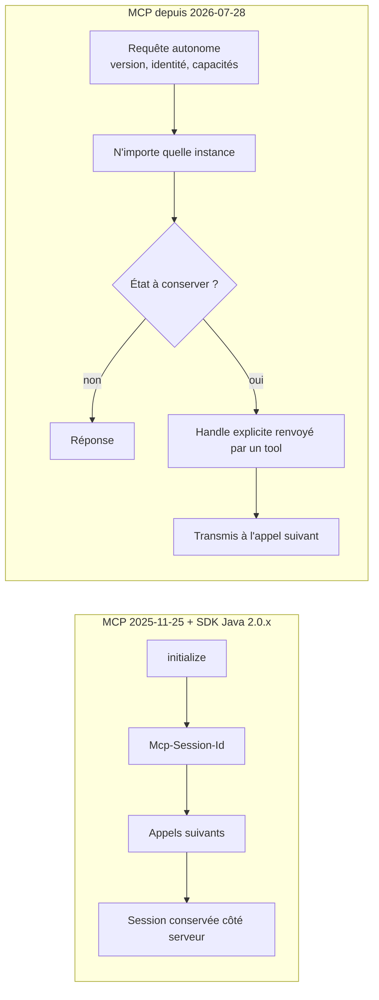
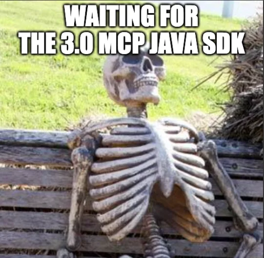
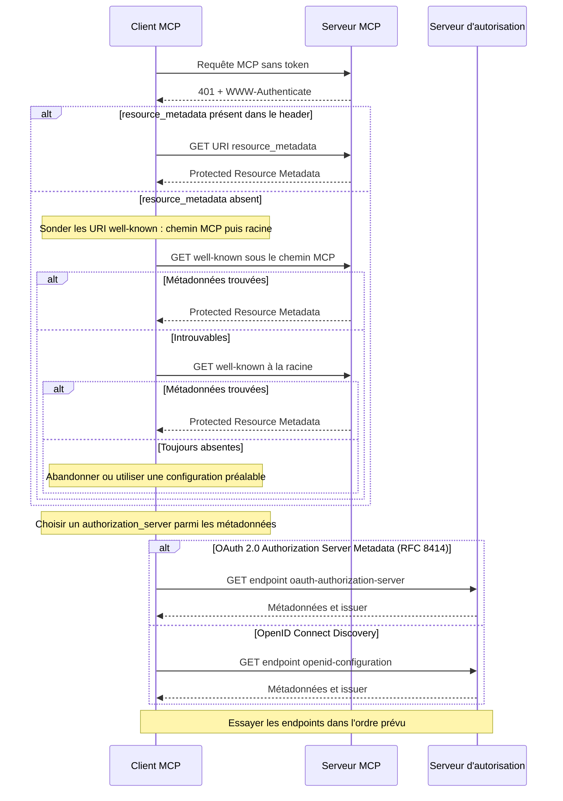

<!-- markdownlint-disable-file -->


# J’ai développé des serveurs MCP en 2026 : la moitié du code est déjà obsolète

> 💡 TL;DR  
> - Un serveur MCP prêt pour la production exige plus que des tools : transport, OAuth, reverse proxy et validation des entrées comptent.  
>   
> - Le tier du SDK révèle son rythme de mise à jour; un décalage peut casser l’interopérabilité sans changement de votre code.  
>   
> - La révision 2026-07-28 supprime les sessions que le SDK Java 2.0.x impose encore : une partie du code de gestion pourrait donc disparaître à sa prochaine mise à jour

## Introduction

J’ai implémenté plusieurs serveurs MCP en production avec Kotlin et Spring Boot, pour exposer des outils à des agents IA sur des périmètres métier distincts. 

Entre un serveur d'exemple et un serveur MCP exposé sur internet, authentifié et déployé derrière un reverse proxy, il y a un écart conséquent. Cet article raconte cet écart, et partage quelques tips pour éviter certains pièges.

## Les sessions MCP, de l'optionnel au problème de production

### **Ce que le transport permet**

Dans la révision [2025-11-25](https://modelcontextprotocol.io/specification/2025-11-25/basic/transports#session-management), l'identifiant de session est optionnel, mais le handshake `initialize` reste obligatoire. Le « stateless » proposé par certains SDK n'est donc pas toujours un mode stateless au sens du protocole.

Un transport stateful permet des capacités serveur vers client comme les [notifications](https://modelcontextprotocol.io/specification/2026-07-28/basic/index#notifications), le [sampling](https://modelcontextprotocol.io/docs/2026-07-28/learn/client-concepts#sampling) et [l'elicitation](https://modelcontextprotocol.io/specification/2026-07-28/client/elicitation). Un transport sans session simplifie le déploiement multi-instances, mais oblige à faire voyager explicitement l'état nécessaire entre les appels.

### **SDK Java 2.0.x**

Le [SDK Java MCP](https://java.sdk.modelcontextprotocol.io/) impose le transport stateful : chaque `initialize` reçoit un `mcp-session-id`, sans option pour désactiver les sessions.

### **Le risque en production**

Le transport conserve les sessions dans une `ConcurrentHashMap` interne sans TTL ni éviction. Le keep-alive est désactivé par défaut et, même activé, un ping en échec ne supprime pas la session. L'éviction native dépend d'une erreur sur le flux GET, d'un DELETE explicite ou de la fermeture du serveur. Après un crash ou un simple timeout réseau, les sessions zombies peuvent donc rester en mémoire indéfiniment.

### **Ce que la dernière révision du protocole change**

La révision [2026-07-28](https://modelcontextprotocol.io/specification/2026-07-28) supprime les sessions et le handshake `initialize`. Chaque requête devient autonome, porte sa version, l'identité du client et ses capacités dans la propriété `_meta`, et peut atteindre n'importe quelle instance. Si le serveur a besoin d'état entre deux appels, il peut renvoyer un handle explicite que le modèle transmettra ensuite.

Le SDK Java 2.0.1 suit encore la révision 2025-11-25. Quand il adoptera la nouvelle révision, une bonne partie du code de gestion des sessions que j'ai écrit pourra disparaître.





## Tous les SDK ne se valent pas : différence de tiers

> _Contexte : classement au 12 septembre 2026, publié pour la première fois le 23 février 2026._

Le [tier](https://modelcontextprotocol.io/community/sdk-tiers) d’un SDK MCP s’évalue sur trois points : sa conformité à la spécification, son délai d’adoption des nouveautés et la réactivité de sa maintenance. Le tableau résume les deux premiers engagements des SDK officiels.

| Tier | C onformité | Nouveautés du protocole | SDK officiels |
| --- | --- | --- | --- |
| Tier 1 | 100 % | avant la sortie de la spec | TypeScript, Python, C#, Go, Rust |
| Tier 2 | 80 % | sous 6 mois | Java, Ruby |
| Tier 3 | aucun minimum | aucun engagement | Swift, PHP, Kotlin |


Ce délai a des conséquences concrètes. Fin juillet 2026, un client a envoyé `server/discover` avant `tools/list`. Le SDK Java a répondu `500` au lieu du `404` attendu, faisant échouer des réponses entières, même sans appel d’outil ([issue #1072](https://github.com/modelcontextprotocol/java-sdk/issues/1072)).

Le tier ne mesure pas la qualité du code : il donne une indication sur le temps nécessaire pour retrouver l’interopérabilité après un changement de protocole.

## Un contrat pour ajouter des tools MCP

### Un contrat par outil

Plutôt que de coupler les outils directement dans la configuration du serveur, j'ai défini une interface `McpToolProvider` qui sert de contrat :

```kotlin
interface McpToolProvider {
  fun toolDefinition(): McpSchema.Tool
  fun handleCall(
    exchange: McpSyncServerExchange,
    request: McpSchema.CallToolRequest,
  ): McpSchema.CallToolResult
}
```

La configuration du serveur (`McpServerConfigBase`) collecte tous les `@Component` implémentant cette interface via injection Spring, et les enregistre automatiquement au démarrage. **Ajouter un nouvel outil = créer un nouveau** **`@Component`** **et rien d'autre à changer.**

### **Exemple de tool**

```kotlin
@Component
class GetSupportedLanguagesTool(
  private val objectMapper: ObjectMapper,
) : McpToolProvider {

  override fun toolDefinition(): McpSchema.Tool = TOOL_DEFINITION

  override fun handleCall(
    exchange: McpSyncServerExchange,
    request: McpSchema.CallToolRequest,
  ): McpSchema.CallToolResult = runCatching {
    jsonResult(mapOf("languages" to SupportedLanguage.entries.map { it.iso2 }), objectMapper)
  }.getOrElse { errorResult("Failed to retrieve supported languages: ${it.message}") }
}
```

## Le flow OAuth est une boîte noire

> _Contexte : implémentation sur Spring Boot 3.5 et Spring Security 6.5, migration vers Spring Boot 4.1 en cours. Constats au 12 septembre 2026._

L'authentification d'un serveur MCP repose sur **OAuth 2.0 / OIDC**, mais la spec MCP s'appuie en plus sur la spécification [**RFC 9728**](https://www.rfc-editor.org/rfc/rfc9728.html) (OAuth 2.0 Protected Resource Metadata) pour permettre aux clients MCP de découvrir automatiquement le serveur d'autorisation. En pratique, implémenter tout ça correctement réserve plusieurs surprises.

Les quatre pièges qui suivent viennent du protocole, du serveur d'autorisation ou du reverse proxy, ils sont applicables quel que soit le langage. 

Le client doit découvrir les métadonnées de la ressource et le serveur d’autorisation avant de poursuivre. Le schéma reprend les variantes de [découverte OAuth prévues par MCP 2026-07-28](https://modelcontextprotocol.io/specification/2026-07-28/basic/authorization/authorization-server-discovery).



### **Quatre pièges sur la découverte**

**Le endpoint de metadata ne peut pas toujours vivre sous** **`/.well-known/`****.** La convention OAuth l'y place, mais un reverse proxy nginx qui sert des fichiers statiques depuis ce path intercepte la requête avant le backend, et vous récupérez un `404` sans aucun log applicatif. 

**Le header** **`WWW-Authenticate`** **doit porter le hint RFC 9728.** Sur un `401`, il doit contenir `resource_metadata="<url>"` pour que le client découvre le endpoint sans le connaître à l'avance, ce que Spring Security ne fait pas nativement avant sa version 7. 

**L'URL publiée doit être l'URL publique.** Derrière nginx, `request.serverName` retourne le nom du service interne et pas le hostname public, donc il faut lire `X-Forwarded-Host` et `X-Forwarded-Proto` en priorité, avec repli sur `Host` puis sur la requête elle-même.

**`scopes_supported`** **est optionnel dans la RFC et obligatoire en pratique.** Keycloak rejette les requêtes d'autorisation sans scope avec `invalid_request`, et un client MCP qui ne trouve de scope ni dans la metadata ni dans le `WWW-Authenticate` en envoie précisément une sans scope.

### **Ce que Spring Security 7 règle**

Spring Security 7, livré avec Spring Boot 4, expose un DSL natif `http.oauth2ResourceServer(rs -> rs.protectedResourceMetadata(...))` qui sert le endpoint RFC 9728 via un filtre dédié ([documentation](https://docs.spring.io/spring-security/reference/servlet/oauth2/resource-server/protected-resource-metadata.html)), et le projet [spring-ai-community/mcp-security](https://github.com/spring-ai-community/mcp-security) s'appuie dessus en couvrant aussi le Dynamic Client Registration. Je suis encore sur Spring Boot 3.5, donc rien de tout ça n'est disponible dans mon contexte et ce qui précède reste nécessaire jusqu'à la fin de ma migration. Si vous démarrez aujourd'hui sur Spring Boot 4, ne le réécrivez pas.

## Valider l’input avant que ça appelle le tool ?

La règle est commune à tous les serveurs MCP. La spécification demande au serveur de valider tous les inputs de ses outils, et l'`inputSchema` n'est qu'un document descriptif que rien n'oblige le client à respecter. C'est une responsabilité du serveur et pas du protocole. Ce qui change d'un SDK à l'autre, c'est ce qu'il fait de ce schéma avant d'appeler votre code.

### La validation manuelle avant le SDK Java 2.0

Avant la version 2.0, un argument absent ou mal typé arrivait quand même dans le handler : il fallait vérifier manuellement chaque champ. En pratique, les entiers reçus comme `Number` plutôt que `Int`, ou les chaînes optionnelles transmises sous la forme `""`, demandaient un traitement particulier.

### **Ce que le SDK 2.0 et Spring AI 2.0 apportent**

Le SDK Java 2.0 valide les arguments contre l'`inputSchema` avant d'appeler le handler. Les valeurs invalides sont renvoyées comme erreur d'outil avec `isError = true`. Les types, champs requis et bornes numériques peuvent donc être déclarés dans le schéma; les règles métier restent dans le handler.

Spring AI 2.0 peut générer le JSON Schema depuis une méthode annotée `@McpTool`. Dans la version décrite ici, les annotations Bean Validation comme `@Min`, `@Size` et `@NotNull` ne sont pas automatiquement reprises dans l'`inputSchema`.

## L’intérêt de solutions nocode pour exposer des API via MCP

Une partie du travail décrit dans cet article consiste à traduire des endpoints existants en outils MCP, et cette partie-là se délègue de deux façons différentes.

Les gateways d'API génèrent un outil par opération à partir d’un fichier OpenAPI, ce que savent faire [Azure API Management](https://learn.microsoft.com/azure/api-management/mcp-server-overview), [Gravitee](https://documentation.gravitee.io/apim/ai-agent-management/convert-your-apis-to-mcp-servers) et [agentgateway](https://agentgateway.dev/). C'est immédiat et c'est aussi la limite, parce qu'un agent choisit un outil sur son nom et sa description. Une API REST bien documentée pour des humains ne produit pas mécaniquement un bon outil pour un modèle, un endpoint REST étant pensé comme une ressource et un outil MCP comme une action.

[reShapr](https://github.com/reshaprio/reshapr) permet de définir en YAML des outils MCP adaptés à une API REST : noms, descriptions, schémas, arguments par défaut, opérations exposées et de fusionner plusieurs API en un seul serveur MCP

[Vidéo de démo de reShapr supportant la version 2026-07-28 du protocole MCP](https://www.youtube.com/watch?v=iqk3lcuASD8)

## Conclusion

Ce qui a coûté le plus cher n'a pas été le protocole, qui se comprend en quelques jours. C'est ce qui vit autour : un reverse proxy qui n’expose pas un chemin de découverte, un serveur d'autorisation qui refuse une requête sans scope, une map de sessions du SDK qui explose en production.

Une bonne partie de ce code a une durée de vie courte. L’écosystème a évolué à plusieurs niveaux : la révision 2026-07-28 du protocole supprime les sessions, les SDK valident les entrées à partir du schéma et Spring AI prend en charge le Protected Resource Metadata. Ces évolutions réduisent le code spécifique à écrire, à des rythmes différents selon les langages.

Face à une configuration déclarative qui expose des outils depuis une spécification existante, dans quels cas un serveur MCP écrit à la main reste-t-il le bon choix ? 

